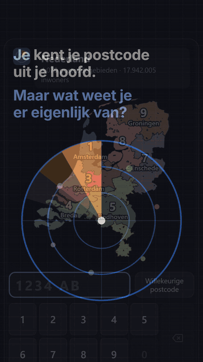

# Postcoderadar (postcoderadar.nl)

Typ een postcode: elk cijfer en elke letter zoomt verder in, van de negen regio's tot één
6-positie postcode met buurt, wijk en CBS-cijfers. Klikken op de kaart gaat een niveau dieper,
Backspace zoomt uit en Esc gaat terug naar heel Nederland. De postcode staat in de URL (`?pc=3512AB`).

<p align="center">
  
</p>

Angular 22 (zoneless, signals), volledig statisch: er is geen backend.

## Ontwerp

- **Renderer in een Web Worker** (OffscreenCanvas), met een fallback op de main thread.
- **Overgangen in drie fasen**: selecteren → zoomen (van Wijk & Nuij) → subgebieden tonen. Teruggaan
  is dezelfde beweging omgekeerd.
- **Snel uitzoomen**: level-of-detail per zoomniveau, alleen de grenzen van het niveau eronder,
  en samengevoegde vlakken per groep ("dissolve").
- **Data op aanvraag**:
  | bestand | inhoud | grootte (brotli) | wanneer geladen |
  |---|---|---|---|
  | `data/pc4.<hash>.bin` | 4070 PC4-vlakken + namen | 375 kB | altijd (preload) |
  | `data/pc6-<hash>/<pc4>.bin` | PC6-vlakken, CBS-cijfers, buurt/wijk | ~6 kB per PC4 | bij 4 cijfers |
  | `data/adr-<hash>/<pc4>.bin` | alle BAG-adressen (straat, huisnummer, positie) | ~7 kB per PC4 | bij de eerste letter; getekend in een PC6 |
- Alle bestanden hebben een hash in hun naam of map en mogen dus voor altijd gecachet worden.

## Gebruik

```bash
npm install
npm start                 # ontwikkelserver
npm run build             # productiebuild + .br/.gz (voor nginx)
npm run build:pages       # productiebuild zonder .br/.gz (voor Cloudflare)
node scripts/serve.mjs    # preview van de build, zelfde headers als nginx (poort 4300)
```

### Tests

Alle tests draaien tegen de productiebuild (`npm run build:pages` eerst), starten zelf een server
en gebruiken de lokale Chrome (of `CHROME_PATH`). Elke test draait op desktop en op een mobiel
profiel (390×844, DPR 3, touch, 4× tragere CPU).

```bash
npm run test:e2e          # functioneel: typen, letters, Backspace/Esc, klikken, willekeurig, geen consolefouten
npm run test:load         # tijd tot de kaart getekend is + bytes, eerste en terugkerend bezoek (mobiel: slow 4G)
npm run test:lighthouse   # Lighthouse-scores, LCP/TBT/CLS voor 3 pagina's
npm run perf:frames       # frametijd (tekenen + rasteren) van de zoomovergangen
npm run test:all          # alles, met budgetten (faalt als een budget overschreden wordt)
```

Laatste meting (lokaal, headless Chrome):

| | desktop | mobiel |
|---|---|---|
| Lighthouse perf / a11y / bp / seo | 100 / 100 / 100 / 100 | 100 / 100 / 100 / 100 |
| LCP | 0,17 s | 0,6 s |
| kaart getekend, eerste bezoek | 0,26 s | 3,1 s (slow 4G) |
| bytes eerste / terugkerend bezoek | 439 kB / 3 kB | 439 kB / 3 kB |

### Data opnieuw genereren

Brondata komt in `data-raw/` (niet in git).

```bash
npm run data:fetch   # CBS PC4 (PDOK) + GeoNames
npm run data:build   # -> public/data/pc4.<hash>.bin
# handmatig in data-raw/ zetten:
#   cbs_pc6_2024_v2.gpkg  uit https://download.cbs.nl/postcode/2026-cbs_pc6_2024_v2.zip
#   gwb/*.csv             uit https://download.cbs.nl/postcode/pc6hnr20260801_gwb.zip
#   bag-light.gpkg        van https://service.pdok.nl/kadaster/bag/atom/downloads/bag-light.gpkg (7,8 GB)
npm run data:pc6     # -> public/data/pc6-<hash>/
npm run data:adr     # -> public/data/adr-<hash>/
```

## Deploy

### Cloudflare (gratis, Workers met statische bestanden)

`wrangler.jsonc` beschrijft de Worker `postcoderadar`: alleen statische bestanden, geen servercode.
`public/_headers` regelt de cache-headers (immutable voor JS, CSS en data), de CSP en het
content-type van de data (zodat Cloudflare het comprimeert). Upload **geen** `.br`/`.gz`:
Cloudflare comprimeert zelf en het gratis plan staat maximaal 20.000 bestanden toe (wij: ~8150).

```bash
npx wrangler@4 login      # eenmalig
npm run deploy            # leegt dist, bouwt, en deployt
```

Domein: `postcoderadar.nl` en `www.postcoderadar.nl` staan als custom domain in `wrangler.jsonc`;
de zone moet actief zijn in hetzelfde Cloudflare-account (nameservers bij de registrar op Cloudflare).
Web Analytics zet je aan in het dashboard; de CSP staat het beacon-script van Cloudflare toe.

### nginx

`npm run build`, kopieer `dist/postcode-atlas/browser/` naar de server en gebruik `deploy/nginx.conf`.

## Nog te doen

- **Frametijden**: sinds de kaart het hele scherm vult (±65% meer pixels) is rasteren de
  bottleneck: desktop ±18–30 ms per frame (mediaan), mobiel (headless, 4× CPU) 30–180 ms bij de
  overgangen op landniveau. Tijdelijk een lagere canvasresolutie tijdens het zoomen gaf pieken door
  het wisselen van canvasgrootte en is teruggedraaid. Volgende stap: een WebGL-renderer
  (driehoeken één keer naar de GPU, dan is een frame alleen nog een transformatie), of
  voorgerenderde bitmaps per niveau die tijdens het zoomen worden geschaald. Meten met
  `npm run perf:frames`.
- **Workers-subdomein**: de deploy staat ook op `postcoderadar.postcode-atlas.workers.dev`; zet
  `workers_dev` op `false` in `wrangler.jsonc` zodra het eigen domein werkt.

## Bronnen

- [CBS, statistische gegevens per postcode](https://www.cbs.nl/nl-nl/dossier/nederland-regionaal/geografische-data/gegevens-per-postcode) (PC4 via [PDOK](https://api.pdok.nl/cbs/postcode4/ogc/v1), PC6), CC BY 4.0
- [CBS, buurt, wijk en gemeente voor postcode-huisnummer](https://www.cbs.nl/nl-nl/maatwerk/2026/38/buurt-wijk-en-gemeente-2026-voor-postcode-huisnummer), CC BY 4.0
- [BAG via PDOK](https://service.pdok.nl/kadaster/bag/atom/bag.xml), CC0
- [GeoNames](https://www.geonames.org/) postal codes, CC BY 4.0
- Idee: [ZIP Code Atlas](https://www.rickwills.com/lab/zip) van Rick Wills
